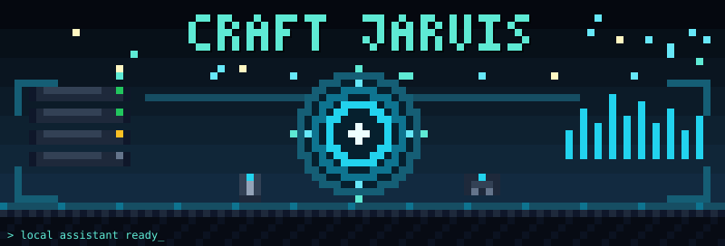
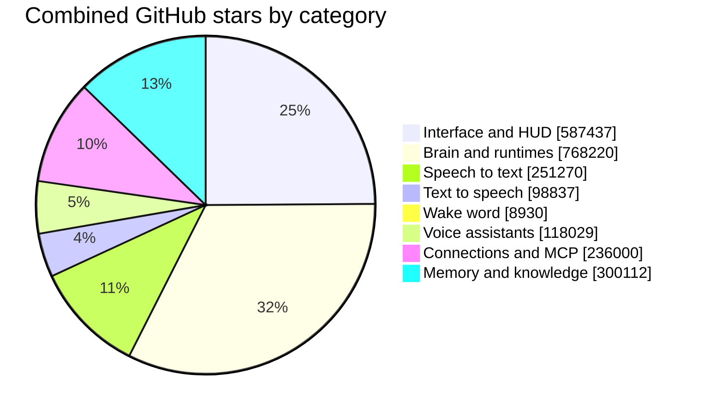

# Awesome Craft Jarvis 

> A curated list of open-source tools to run a personal JARVIS-style AI assistant locally, including dashboards, agent runtimes, voice, MCP connections and memory.

Open-source tools now cover most of a personal assistant stack you can run on your own machine: chat and HUD interfaces, local model runtimes and agent frameworks, speech input and output, connectors for accounts you already use, and memory stores. Every GitHub entry below was checked on 2026-11-15. Check each project's licence before you deploy or sell anything built on it.

**Safety:** a local assistant can still leak secrets, send mail, change files or keep a microphone open. Keep credentials in a local dotfolder and out of Git, treat connected servers as read-only until you allow changes, and do not run tools with permission checks disabled. This list is not a setup guide, a security audit or legal advice.

## Contents

- [Dashboard](#dashboard)
- [Interface and HUD](#interface-and-hud)
- [Brain and runtimes](#brain-and-runtimes)
- [Speech to text](#speech-to-text)
- [Text to speech](#text-to-speech)
- [Wake word](#wake-word)
- [Voice assistants](#voice-assistants)
- [Connections and MCP](#connections-and-mcp)
- [Memory and knowledge](#memory-and-knowledge)
- [Safety and operations](#safety-and-operations)
- [Inspiration](#inspiration)
- [Related lists](#related-lists)
- [Star history](#star-history)

## Dashboard

<table>
<tr>
<td align="center"><h2>59</h2>listed projects</td>
<td align="center"><h2>8</h2>categories</td>
<td align="center"><h2>2.37M</h2>combined GitHub stars</td>
<td align="center"><h2>394.6k</h2>combined forks</td>
<td align="center"><h2>50/59</h2>pushed in the last 30 days</td>
<td align="center"><h2>9</h2>languages</td>
</tr>
</table>

**Evidence tags**

<table>
<tr><th>Tag</th><th>Style</th><th>Meaning</th></tr>
<tr><td>FACT</td><td>solid underline</td><td>A measured figure, with the source named.</td></tr>
<tr><td>GOAL</td><td>dashed underline</td><td>A stated roadmap, price, ship date or plan, not a result.</td></tr>
<tr><td>ESTIMATE</td><td>dotted underline</td><td>A sum or count we computed from the facts.</td></tr>
</table>

This snapshot's dashboard has no GOAL figures. None of the dashboard numbers come from project roadmaps.

**Sources and method**

- Star counts, fork counts, licences, primary languages and last-push dates are FACT values from the GitHub REST API (`GET /repos/{owner}/{repo}`) on 2026-11-15.
- Combined stars (2.37M) and combined forks (394.6k) are ESTIMATEs: the arithmetic sum of those per-repository FACT counts, with no weighting and no unique-user deduplication. A person who stars two projects is counted twice.
- Pushed in the last 30 days (50/59) is an ESTIMATE: the number of listed repositories whose FACT `pushed_at` date is on or after 2026-10-16.
- Language and category counts, and the licence badges, are ESTIMATEs of FACT fields. Star badges next to each entry update live and may differ from this snapshot.

### 🏆 Leaderboard

Star counts in this table are FACT values from the snapshot. The bars are only a visual scale.

<table>
<tr><th>Rank</th><th>Project</th><th>Kind</th><th align="right">Stars</th><th></th></tr>
<tr><td align="center">🥇</td><td><b>Ollama</b></td><td>Brain and runtimes</td><td align="right">187.0k</td><td><code>████████████████████</code></td></tr>
<tr><td align="center">🥈</td><td><b>Open WebUI</b></td><td>Interface and HUD</td><td align="right">158.7k</td><td><code>█████████████████</code></td></tr>
<tr><td align="center">🥉</td><td><b>llama.cpp</b></td><td>Brain and runtimes</td><td align="right">135.2k</td><td><code>██████████████</code></td></tr>
<tr><td align="center">4</td><td><b>Whisper</b></td><td>Speech to text</td><td align="right">112.8k</td><td><code>████████████</code></td></tr>
<tr><td align="center">5</td><td><b>vLLM</b></td><td>Brain and runtimes</td><td align="right">97.0k</td><td><code>██████████</code></td></tr>
<tr><td align="center">6</td><td><b>Home Assistant</b></td><td>Voice assistants</td><td align="right">92.3k</td><td><code>██████████</code></td></tr>
<tr><td align="center">7</td><td><b>MCP Reference Servers</b></td><td>Connections and MCP</td><td align="right">92.0k</td><td><code>██████████</code></td></tr>
<tr><td align="center">8</td><td><b>NextChat</b></td><td>Interface and HUD</td><td align="right">89.0k</td><td><code>██████████</code></td></tr>
<tr><td align="center">9</td><td><b>LobeHub</b></td><td>Interface and HUD</td><td align="right">85.6k</td><td><code>█████████</code></td></tr>
<tr><td align="center">10</td><td><b>Mem0</b></td><td>Memory and knowledge</td><td align="right">69.0k</td><td><code>███████</code></td></tr>
</table>

### Stars by category

These category totals are ESTIMATE sums of the per-repository FACT star counts.

### Licences

        

These badge counts are ESTIMATE tallies of the SPDX identifier GitHub returned for each repository. "Custom" or "None" means GitHub could not match a standard SPDX licence. Some projects also ship model or branding terms alongside the code, which are flagged in the entry. Read each project licence before you use it commercially.

## Interface and HUD

Local and self-hosted chat interfaces and heads-up dashboards you can run on your own machine, including React and other web or desktop UIs.

- [AnythingLLM](https://github.com/Mintplex-Labs/anything-llm) - All-in-one self-hosted app for chatting with documents and local or remote models, with an OpenAI-compatible API. 
- [big-AGI](https://github.com/enricoros/big-AGI) - Local TypeScript suite, built with a web UI, for chatting with local and remote models and running productivity tools. 
- [Jan](https://github.com/janhq/jan) - Desktop app for running models fully offline on your computer. GitHub reports no standard SPDX licence, so read the repository before you use it. 
- [Khoj](https://github.com/khoj-ai/khoj) - Self-hostable personal assistant that can answer questions from your files and the web. 
- [LibreChat](https://github.com/LibreChat-AI/LibreChat) - Self-hosted chat UI, written in TypeScript and React, with agents, MCP support and many model backends. 
- [LobeHub](https://github.com/lobehub/lobehub) - Web and desktop chat UI, formerly published as Lobe Chat, for talking to local and remote models. GitHub reports no standard SPDX licence, so read the repository before you use it. 
- [NextChat](https://github.com/ChatGPTNextWeb/NextChat) - Cross-platform chat app, built with Next.js, React and Tauri, that can talk to Ollama and other model backends. 
- [Open Space](https://github.com/Fantomiald/open-space) - Pixel-art desktop office for running several Claude Code sessions at once, with permission prompts, scheduled runs and side-by-side threads. Uses your locally installed Claude Code. 
- [Open WebUI](https://github.com/open-webui/open-webui) - Self-hosted web interface for Ollama and OpenAI-compatible servers. GitHub reports no standard SPDX licence. The project uses a source-available licence with extra branding terms, so read it before you rename or redistribute the interface. 
- [textgen](https://github.com/oobabooga/textgen) - Local desktop app for running LLMs, with text, vision, tool calling and an OpenAI-compatible API. Previously published as text-generation-webui. 

## Brain and runtimes

Model runtimes you can host locally, plus agent frameworks that can plan, call tools and keep a loop going. Several of these can also use a hosted API. Read each project's authentication docs; this list does not claim that any of them is free to run.

- [AutoGen](https://github.com/microsoft/autogen) - Programming framework for multi-agent applications. GitHub reports a CC-BY-4.0 licence, which is a Creative Commons licence rather than a typical OSI software licence. Read the repository before you use it. 
- [Claude Agent SDK (Python)](https://github.com/anthropics/claude-agent-sdk-python) - Official Python SDK from Anthropic for building agents with the Claude Agent SDK. Read Anthropic's documentation for authentication and usage requirements. 
- [Claude Agent SDK (TypeScript)](https://github.com/anthropics/claude-agent-sdk-typescript) - Official TypeScript SDK from Anthropic for the Claude Agent SDK. GitHub reports no SPDX licence, so read the repository before you use it. 
- [CrewAI](https://github.com/crewAIInc/crewAI) - Python framework for composing role-based autonomous agents that work together on a task. 
- [LangGraph](https://github.com/langchain-ai/langgraph) - Library for building stateful, resilient agents as graphs, from the LangChain team. 
- [llama.cpp](https://github.com/ggml-org/llama.cpp) - C/C++ library and CLI for running large language models locally on CPUs and GPUs. 
- [LocalAI](https://github.com/mudler/LocalAI) - Self-hosted OpenAI-compatible API that can run language, vision and audio models on your own hardware. 
- [Ollama](https://github.com/ollama/ollama) - Easy local runner and API for downloading and serving open models on your machine. 
- [Open Interpreter](https://github.com/openinterpreter/openinterpreter) - The Open Interpreter project, a local coding agent that can run open models and use tools on your machine. 
- [Pydantic AI](https://github.com/pydantic/pydantic-ai) - Python agent framework from the Pydantic team, with typed tools and support for several model providers. 
- [smolagents](https://github.com/huggingface/smolagents) - Small Python library from Hugging Face for building agents that write and run code as their actions. 
- [vLLM](https://github.com/vllm-project/vllm) - High-throughput inference and serving engine for large language models. 

## Speech to text

Local and self-hostable speech recognition tools, from Whisper and its faster ports to Vosk and on-device ONNX runtimes.

- [faster-whisper](https://github.com/SYSTRAN/faster-whisper) - Faster reimplementation of OpenAI Whisper transcription, built on CTranslate2. 
- [sherpa-onnx](https://github.com/k2-fsa/sherpa-onnx) - On-device speech toolkit with speech-to-text, text-to-speech and related tasks, using ONNX Runtime. 
- [Vosk](https://github.com/alphacep/vosk-api) - Offline speech recognition API that can run on servers, desktops and small devices such as a Raspberry Pi. 
- [Whisper](https://github.com/openai/whisper) - OpenAI's open-source speech recognition model and inference code, widely used as a local transcriber. 
- [whisper.cpp](https://github.com/ggml-org/whisper.cpp) - C/C++ port of Whisper for running speech recognition locally with no Python dependency. 
- [WhisperX](https://github.com/m-bain/whisperX) - Whisper-based transcription with word-level timestamps and speaker alignment. 

## Text to speech

Local neural text-to-speech engines, including Kokoro, Piper, Coqui and other open models. Check model licences as well as the inference code.

- [Chatterbox](https://github.com/resemble-ai/chatterbox) - Open-source text-to-speech model and inference code from Resemble AI. 
- [Coqui TTS (Idiap fork)](https://github.com/idiap/coqui-ai-TTS) - Maintained community fork, hosted by Idiap, of the Coqui deep-learning text-to-speech toolkit. The original coqui-ai/TTS repository was last pushed on 2024-08-16. 
- [F5-TTS](https://github.com/SWivid/F5-TTS) - Open-source text-to-speech model and official inference code for F5-TTS. 
- [Fish Speech](https://github.com/fishaudio/fish-speech) - Open-source text-to-speech project. GitHub reports no standard SPDX licence, so read the repository, including any model terms, before you use it commercially. 
- [Kokoro](https://github.com/hexgrad/kokoro) - Lightweight open-source text-to-speech model and inference code. Last pushed on 2025-08-06. 
- [Kokoro ONNX](https://github.com/thewh1teagle/kokoro-onnx) - Local text-to-speech runtime that serves Kokoro models through ONNX Runtime. 
- [Piper 1](https://github.com/OHF-Voice/piper1-gpl) - Fast, local neural text-to-speech engine from the Open Home Foundation, the maintained successor to the archived rhasspy/piper project. The code is GPL-3.0. 

## Wake word

On-device detectors that can listen for a wake word or phrase before the rest of the assistant starts recording.

- [Mycroft Precise](https://github.com/MycroftAI/mycroft-precise) - Lightweight recurrent wake-word listener from the Mycroft project. Last pushed on 2023-11-25, so review whether it still meets your needs. 
- [openWakeWord](https://github.com/dscripka/openWakeWord) - Open-source wake-word and wake-phrase detection framework intended to be simple to train and run locally. 
- [Porcupine](https://github.com/Picovoice/porcupine) - On-device wake-word detection library. Read the licence before commercial use, including any terms that apply beyond the SPDX identifier GitHub reports. 

## Voice assistants

Full voice-assistant stacks, including Home Assistant voice, the Wyoming protocol that replaced much of Rhasspy, Leon, and Mycroft's archived core with its OpenVoiceOS successor.

- [Home Assistant](https://github.com/home-assistant/core) - Open-source home automation platform, including a voice assistant that can run speech locally over the Wyoming protocol. 
- [Leon](https://github.com/leon-ai/leon) - Self-hosted personal assistant with a web interface, skills and a local-first design. 
- [Linux Voice Assistant](https://github.com/OHF-Voice/linux-voice-assistant) - Voice satellite for Home Assistant on Linux, using the ESPHome protocol, from the Open Home Foundation. 
- [Mycroft](https://github.com/MycroftAI/mycroft-core) - Archived core of the Mycroft voice assistant. Prefer OpenVoiceOS for current development. This snapshot last saw a push on 2024-09-08. 
- [OpenVoiceOS](https://github.com/OpenVoiceOS/ovos-core) - Active open-source voice assistant platform that continues the Mycroft core as a community fork. 
- [Wyoming](https://github.com/OHF-Voice/wyoming) - Peer-to-peer protocol and Python library used to connect local speech services to Home Assistant and other voice assistants. 

## Connections and MCP

Connect an assistant only to accounts you control. Keep OAuth tokens and API keys in a local dotfolder, never in Git or in a page the browser can read. Start each server read-only, and switch on write access per server only when you need it.

- [Composio](https://github.com/ComposioHQ/composio) - Platform and open-source tooling that exposes a large set of third-party toolkits, including CRM, calendar, email and social APIs, to agents. Authorize each account yourself and keep tokens off Git. 
- [FastMCP](https://github.com/PrefectHQ/fastmcp) - Python framework, now maintained under Prefect, for building MCP servers and clients. 
- [GitHub MCP Server](https://github.com/github/github-mcp-server) - Official GitHub MCP server for letting an agent work with repositories and issues that you have authorized. 
- [MCP Inspector](https://github.com/modelcontextprotocol/inspector) - Official deterministic testing and inspection tools for MCP servers, useful when you are checking what a server is allowed to do. GitHub reports no standard SPDX licence, so read the repository before you use it. 
- [MCP Python SDK](https://github.com/modelcontextprotocol/python-sdk) - Official Python SDK for building Model Context Protocol servers and clients. 
- [MCP Reference Servers](https://github.com/modelcontextprotocol/servers) - Official reference MCP servers for connecting an agent to local files and to third-party services such as mail or chat, with your own credentials. GitHub reports no standard SPDX licence, so read the repository, including the licence of each bundled server, before you deploy one. 
- [MCP TypeScript SDK](https://github.com/modelcontextprotocol/typescript-sdk) - Official TypeScript SDK for building Model Context Protocol servers and clients. GitHub reports no standard SPDX licence, so read the repository before you use it. 

## Memory and knowledge

Stores and frameworks that let an assistant keep long-term context, including memory layers, knowledge graphs and vector databases.

- [Chroma](https://github.com/chroma-core/chroma) - Open-source embedding database for storing and searching vectors used by assistants and RAG pipelines. 
- [Faiss](https://github.com/facebookresearch/faiss) - Library from Meta for efficient similarity search and clustering of dense vectors. 
- [Graphiti](https://github.com/getzep/graphiti) - Framework for building real-time knowledge graphs that agents can query as memory. 
- [GraphRAG](https://github.com/microsoft/graphrag) - Modular graph-based retrieval-augmented generation system from Microsoft. 
- [LanceDB](https://github.com/lancedb/lancedb) - Embedded multimodal retrieval library and vector store that can run next to an application. 
- [Letta](https://github.com/letta-ai/letta) - Platform for stateful agents with a long-term memory system, originally known as MemGPT. 
- [LlamaIndex](https://github.com/run-llama/llama_index) - Document processing and retrieval framework for connecting files and data sources to language models. 
- [Mem0](https://github.com/mem0ai/mem0) - Memory layer for AI agents that stores and retrieves long-term context across sessions. 

## Safety and operations

A local assistant can still leak secrets, send mail, change files or keep a microphone open. This section is guidance, not a setup guide, a security audit or legal advice.

- Keep API keys, OAuth tokens and service credentials in a local folder such as `~/.jarvis` (or another dotfolder on disk), with permissions limited to your user account. Never commit secrets, never put them in a public gist, and never ship them in a client-side bundle or a page the browser can read.
- Treat every connected MCP server and skill as read-only until you explicitly allow changes for that server. A calendar or mail server that can send or delete is a different risk from one that can only read.
- Provide `boot`, `stop` and `doctor` scripts (or the equivalent) so you can start the stack, shut it down, and run a PASS/FAIL health check without guessing at process state.
- Do not run an assistant, agent SDK or MCP host with permission checks disabled or in a bypass-permissions mode. If a tool cannot do its job without a bypass, do not run that tool until you understand and accept the specific permission it needs.
- Voice assistants and always-on microphones record audio in your home or office. Review what is stored, where it is processed (on the machine versus a remote API), and who can access the transcript.
- The MCP Inspector entry in Connections and MCP is one way to inspect what a server exposes before you grant it write access.

## Inspiration

The category layout of this list (interface, brain, voice, connections, memory, and a safety section) was inspired by a public social post about running a JARVIS-style assistant on a local machine. The post is not a source of tools, claims or setup instructions, and this list does not reproduce its prompts, artwork or product pitches.

## Related lists

Other lists in the Awesome Craft series:

- [Awesome Craft](https://github.com/EdisonTKPcom/Awesome-Craft) - A curated list of open-source, self-hostable alternatives to popular SaaS tools.
- [Awesome Craft Agents](https://github.com/EdisonTKPcom/Awesome-Craft-Agents) - A curated list of open-source chat apps, coding agents, self-hosted agent bots, workflow automation and image-generation UIs.
- [Awesome Craft AI](https://github.com/EdisonTKPcom/Awesome-Craft-AI) - A curated list of open-source, self-hostable AI runtimes, servers, Hugging Face libraries and related infrastructure.
- [Awesome Craft BSC](https://github.com/EdisonTKPcom/Awesome-Craft-BSC) - A curated list of verified open-source clients, SDKs, dev tools and protocol code for BNB Smart Chain and opBNB.
- [Awesome Craft CUDA](https://github.com/EdisonTKPcom/Awesome-Craft-CUDA) - A curated list of open-source CUDA learning material, kernel libraries, tooling and portability projects.
- [Awesome Craft DeepSeek](https://github.com/EdisonTKPcom/Awesome-Craft-DeepSeek) - A curated list of official DeepSeek repositories and open-source harnesses, serving engines, eval tools and fine-tuning stacks that work with DeepSeek models.
- [Awesome Craft DevOps](https://github.com/EdisonTKPcom/Awesome-Craft-DevOps) - A curated list of open-source, self-hostable alternatives to popular DevOps and hosting SaaS tools.
- [Awesome Craft DNA](https://github.com/EdisonTKPcom/Awesome-Craft-DNA) - A curated list of open-source tools for DNA, genomics and synthetic biology.
- [Awesome Craft Ethereum](https://github.com/EdisonTKPcom/Awesome-Craft-Ethereum) - A curated list of verified open-source Ethereum clients, SDKs, dev frameworks, wallets and security tools.
- [Awesome Craft EV](https://github.com/EdisonTKPcom/Awesome-Craft-EV) - A curated list of open-source software and hardware for electric vehicles and charging.
- [Awesome Craft Hardware](https://github.com/EdisonTKPcom/Awesome-Craft-Hardware) - A curated list of open-source tools for PCB, FPGA, ASIC and chip design.
- [Awesome Craft Hyperliquid](https://github.com/EdisonTKPcom/Awesome-Craft-Hyperliquid) - A curated list of verified open-source SDKs, node tools, analytics and community libraries for the Hyperliquid ecosystem.
- [Awesome Craft Malaysia](https://github.com/EdisonTKPcom/Awesome-Craft-Malaysia) - A curated list of open-source tools useful to Malaysian SMEs, with verified MyInvois support called out separately.
- [Awesome Craft Mars](https://github.com/EdisonTKPcom/Awesome-Craft-Mars) - A curated list of open-source tools and open data for Mars missions and settlement planning.
- [Awesome Craft Neuro](https://github.com/EdisonTKPcom/Awesome-Craft-Neuro) - A curated list of open-source tools for brain-computer interfaces, electrophysiology and neurotechnology.
- [Awesome Craft Robotics](https://github.com/EdisonTKPcom/Awesome-Craft-Robotics) - A curated list of open-source robotics software and hardware, including Microduck, Unitree SDKs, open humanoids, arms, simulation and middleware.
- [Awesome Craft Solana](https://github.com/EdisonTKPcom/Awesome-Craft-Solana) - A curated list of verified open-source Solana clients, SDKs, frameworks, explorers and program libraries.
- [Awesome Craft Space](https://github.com/EdisonTKPcom/Awesome-Craft-Space) - A curated list of open-source tools for spaceflight and rockets, covering orbit simulation, telemetry, launch data and more.
- [Awesome Craft Starlink](https://github.com/EdisonTKPcom/Awesome-Craft-Starlink) - A curated list of open-source tools for Starlink and other LEO satellite internet systems.
- [Awesome Craft Web3](https://github.com/EdisonTKPcom/Awesome-Craft-Web3) - A curated list of open-source DEX protocol code, self-custody software, indexers, frameworks and Blockchain infrastructure.

## Star history

## Contributing

Contributions welcome! Read the [contribution guidelines](contributing.md) first.

If this list helped you find a tool, give it a ⭐ so others can find it.

